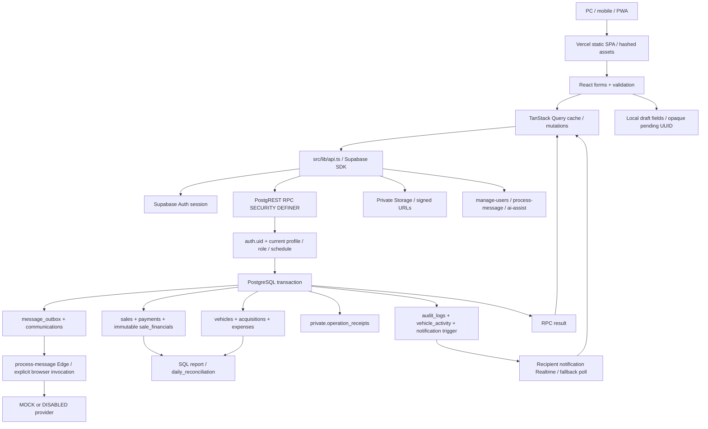

# Architecture and concurrency forensic audit

Ngày kiểm tra: 2026-10-06. Phạm vi: mã nguồn và PostgreSQL tạm trên máy phát triển, dữ liệu giả. Không kết nối production, không gửi tin nhắn thật, không triển khai, không thay đổi Git index.

## Quy ước bằng chứng

- **PASS**: invariant cụ thể có bằng chứng thực thi hoặc điều kiện SQL trực tiếp đủ để kết luận cho phạm vi được ghi. Không có nghĩa toàn bộ luồng đã kiểm tra trên Supabase hosted.
- **FAIL**: đã tái hiện kết quả trái invariant bằng mã thật trong môi trường tạm.
- **PARTIAL**: có bảo vệ một phần, thiếu cơ chế hoặc còn đường tương thích cũ không bảo vệ.
- **NOT VERIFIED**: chưa chạy kiểm chứng phù hợp hoặc tính năng thực tế chưa có.
- Severity theo master prompt: P0 cho ghi đè tiền, trùng giao dịch gây sai sổ, bypass quyền; P1 cho gián đoạn vận hành/recovery; P2 cho UX, traceability, tác vụ phụ; P3 cho cải tiến rủi ro thấp.

Kết quả baseline bên dưới được chụp khi migration mới nhất là `20261006000200_operation_receipts.sql`. Các bản sửa đang được phát triển song song phải chạy lại diagnostics; không được suy kết quả baseline thành trạng thái sau sửa.

## Trạng thái mới nhất sau local hardening

Run lại EXT sau migrations qua `20261006000800_knowledge_reseed.sql`: **20 PASS / 2 FAIL, exit 1**. Có 22 checks; ba checks mới kiểm tra MANAGER bị disable trong lúc cancel/delete chờ vehicle lock. Test-only listener warning không xuất hiện ở run này sau sửa harness bởi root.

| Finding baseline | Trạng thái hiện tại / bằng chứng chạy lại |
|---|---|
| Case variants chassis duplicate | **PASS**: canonical unique index migration 060004; exact/canonical manual/import/bulk invariants đều pass. |
| Expense financial overwrite | **PARTIAL**: updated UI sends expected revision, guarded race pass với migration 060005; legacy no-token callers vẫn accepted both và diagnostic giữ **FAIL**. |
| Expense revocation while waiting | **PASS** với migration 060005, old payload không token cũng bị revoked manager chặn sau lock. |
| PROCESSING crash stuck | **FAIL** còn tồn tại; không tự resend provider result mơ hồ để che issue. |
| Claim sau sale cancel | **PASS** cho cancel-đã-commit-before-claim với migration 060007. Cancel racing already claimed/send **NOT VERIFIED**; guard SELECT không khóa sale, không phải send fencing protocol. |
| Swallowed outbox failure | **PASS**: migration 060007 ghi safe audit incident, core sale còn COMPLETED; trigger fault injection thật. |
| Acquisition/vehicle deadlock | **PASS** sau migration 060006: actual RPCs chạy với ordered gate và không prelock acquisition nghịch giả tạo; vehicle delete vs cancel-acquisition, vehicle delete vs delete-acquisition đều pass. |
| Revoked cancellation/deletion | **PASS** cho cancel_acquisition/delete_acquisition/delete_vehicle sau vehicle lock wait; các mutators khác không được suy pass theo. |

Hai FAIL còn lại là release diagnostics có chủ đích ghi đúng invariant chưa đạt, không bị skip hoặc sửa expectation để xanh. `CORE` còn kiểm tra duplicate receipt khác UUID; tổng kết CORE và toàn bộ regression nằm ở báo cáo điều phối. Ma trận 25 và root cause ở phần dưới giữ **baseline lịch sử** để thể hiện lỗi tìm ra và vì sao sửa, dùng bảng current này khi đánh giá trạng thái hiện tại.

## 1. Kiến trúc thực tế

Repository **không phải Next.js**. `package.json`, `vite.config.ts`, `vercel.json` xác nhận React 19 + TypeScript + Vite 7, React Router, React Hook Form/Zod, TanStack Query. Vercel phục vụ `dist` với rewrite SPA. Không có Next API routes/server actions. Supabase SDK gọi PostgREST RPC, Auth, Storage và Edge Functions trực tiếp từ trình duyệt.

### Ranh giới transaction và tài nguyên chung

| Đường ghi | Transaction/thứ tự tài nguyên | Bằng chứng |
|---|---|---|
| Thu xe | vehicle + financial row + acquisition + audit; một RPC; frame unique | `acquire_vehicle` trong migration 011; wrapper receipts trong migration 060002 |
| Thu nhiều xe | table lock `SHARE ROW EXCLUSIVE`, validate rồi loop thu; toàn batch một transaction | `import_vehicles` migration 011; lỗi ở dòng sau rollback cả batch được test |
| Bán xe | khóa vehicle, kiểm tra availability/cost/date, insert sale/snapshot/initial payment, SOLD + audit | `sell_vehicle_impl` được giữ từ migration 012; partial unique completed-sale trong schema 001 |
| Thu công nợ | khóa vehicle rồi sale; tính SUM active payments dưới khóa; request UUID + kiểm tra actor/payload | `add_payment`, migration 012 |
| Hủy bán | khóa vehicle rồi sale; void các khoản thu, trả IN_STOCK; snapshot vẫn giữ | `cancel_sale`, migration 002 |
| Chi phí xe | khóa vehicle rồi expense; chặn xe SOLD/CANCELLED | `save_expense`/`cancel_expense`, migration 002 |
| Chi phí cửa hàng | khóa expense; baseline không revision precondition | `save_expense`, migration 002 |
| Hủy phiếu thu | baseline khóa acquisition rồi vehicle | `cancel_acquisition`, migration 005 |
| Xóa xe | khóa vehicle rồi xóa acquisition/financials/expenses/images/activity; chặn mọi lịch sử bán | `private.purge_vehicle`, migration 037 |
| Xóa phiếu thu | baseline khóa acquisition rồi gọi helper khóa vehicle | `delete_acquisition`, migration 037 |
| Hạn trả công nợ | khóa sale; overload mới nhận expected updated_at | migrations 023/060001; hàm hai tham số cũ vẫn tồn tại |
| Quyền nhân sự | advisory xact lock 761482190 + profile; bảo vệ một active OWNER | `update_profile`/`transfer_ownership`, migration 036 |
| Tin nhắn | outbox nằm trong nested exception block; lỗi phụ không hủy sale; claim atomic conditional UPDATE | migration 026 và bản body sale 012 |

Browser roles bị thu hồi quyền ghi trực tiếp các bảng nghiệp vụ; RPC definer phải tự kiểm tra quyền vì definer có thể vượt RLS. `search_path=''` và grants được liệt kê trong migration 031. Kiểm tra auth/profile được thực hiện ở server, không dùng role từ payload.

### Tính năng thực tế và phạm vi chưa có

| Tính năng | Trạng thái thực tế |
|---|---|
| Đang cọc | Có enum `RESERVED` và UI đổi status xe. Không tìm thấy deposit entity, amount, khách đặt cọc, owner, expiry, refund hoặc hold token. Xe RESERVED vẫn được bán bởi mọi role vận hành hợp lệ. Không được coi đây là hệ thống quản lý tiền cọc. |
| Khách hàng | Là query tổng hợp sale theo số điện thoại đã normalize. Không có bảng customer master hoặc RPC sửa customer. Lead showroom có bảng/status riêng. |
| Công nợ | Derived `sale_price - SUM(ACTIVE payments)`; có due_date. Không có debt master mutable balance hoặc adjustments. |
| Hoàn tiền | Hủy sale void các khoản thu để loại khỏi totals. UI yêu cầu đối chiếu hoàn trả tiền bên ngoài hệ thống. Không có refund ledger/reconcile-refund RPC. |
| Đối soát ngày | RPC đọc totals/chứng từ. Không có chốt ngày, số dư quỹ đầu cuối, đếm quỹ thật hoặc signed daily close. |
| Bulk | Có CSV/shorthand import tối đa 500 dòng. Không thấy bulk bán/xóa/cancel inventory. |
| Worker | Edge `process-message` chạy theo message_id, provider MOCK/DISABLED; không thấy cron worker trong repo. Frontend bán/retry gọi explicit. Không có lease reclamation baseline. |
| Offline | Cache app shell/assets; draft giới hạn field; mutations online. Không có offline financial queue hoặc background sync. |

## 2. Ma trận 25 tình huống A2

`EXT` là `tests/db/extended-concurrency-audit.mjs`; `CORE` là `tests/db/concurrency-audit.mjs`. EXT dùng PostgreSQL native multi-session, barrier khóa rồi quan sát `pg_stat_activity.wait_event_type='Lock'` trước mở khóa. Assertions kiểm tra bảng/audit thật. CORE có một số case retry tuần tự đúng bản chất replay; không gọi đó là test concurrent.

| # | Operation / xung đột | Bảo vệ và bằng chứng | Failure / severity / hướng nhỏ nhất | Test và status baseline |
|---|---|---|---|---|
| 1 | Hai người thu cùng chassis | Unique frame + transaction; migration 005/011 | Cùng string an toàn; upper/lowercase tạo 2 rows vì uniqueness case sensitive. P0 identity duplication. Unique expression canonical, preflight dữ liệu trước thêm index, không tự merge. | CORE exact string PASS; EXT canonical case FAIL. **FAIL** |
| 2 | Bán xe vs đổi Đang cọc | Cả hai khóa vehicle; sell cho IN_STOCK/RESERVED; SOLD edit locked | SOLD không bị revert. Đang cọc chưa gắn khách/tiền nên không bảo đảm quyền sở hữu đặt cọc. Không tự invent nghiệp vụ hold. | EXT reservation-vs-sale PASS; deposit ownership **NOT VERIFIED**. **PARTIAL** |
| 3 | Hai người đặt cọc | UI status edit gửi vehicle expected revision từ migration 012 | Versioned edit chỉ một commit; legacy không token có thể cả hai được nhận. Tiền cọc thật chưa có. | EXT versioned reservation PASS. **PARTIAL** |
| 4 | Hủy cọc vs hoàn tất bán | Không có cancel-deposit RPC; về thực chất save status | Không thể kiểm chứng refund/cancel-deposit atomic; status SOLD vẫn được bảo vệ. | **NOT VERIFIED**, feature absent |
| 5 | Sửa xe vs bán | Vehicle lock serialize financial edit/sale; SOLD financial locked; snapshot immutable | Cost không drift sau bán; sửa metadata không revision vẫn last writer. | EXT financial edit/sale PASS; CORE stale versioned edit PASS. **PARTIAL** |
| 6 | Đổi inventory status vs giao dịch | save_vehicle cấm trực tiếp SOLD; sale state kiểm tra dưới khóa | Sau khi sale commit status không thể quay RESERVED từ stale form. CANCELLED edit STAFF bị chặn. | EXT/CORE sale/status PASS. **PASS** cho invariant SOLD |
| 7 | Hai người sửa customer | Customer là aggregate từ sales; không có edit endpoint | Không có customer version conflict để kiểm tra. Showroom lead status chỉ row update, chưa revision. | **NOT VERIFIED**, feature absent |
| 8 | Hai người sửa debt | Balance derived; due_date mới có expected token; legacy 2-param giữ nguyên | Old client due-date last writer. Không có edit principal/adjustment API. UI mới phải fail closed nếu không token. | CORE baseline cũ due-date FAIL; overload mới cần test riêng. **PARTIAL** |
| 9 | Hai khoản thu độc lập cùng nợ | Vehicle→sale lock, SUM server; active debt cap | 2 receipt độc lập được nhận nếu tổng <= balance; không phụ thuộc cached remaining. | EXT payments 200+200=400 PASS; CORE overpay PASS. **PASS** |
| 10 | Hai người ghi cùng khoản thu thật | UUID idempotency + actor/payload guard | Khác UUID/actor/thiết bị vẫn được coi hai receipt. Không an toàn khi suy duplicate từ amount/date. P0 sai totals. Cần business receipt identity/cross-user workflow được xác nhận. | CORE distinct request IDs FAIL. Same UUID replay PASS. **PARTIAL** |
| 11 | Refund vs sửa/đối soát payment | Chỉ sale cancellation void; payment immutable fields qua public API | Không có real refund/payment edit workflow; không claim xử lý cash refund. | **NOT VERIFIED**, feature absent |
| 12 | Hai người hủy transaction | Vehicle→sale lock; completed status check; void + audit trong cùng RPC | Loser controlled `SALE_ALREADY_CANCELLED`; không double-void effect | EXT overlapping cancellation PASS. **PASS** |
| 13 | Delete/disable/edit record vs sử dụng | Delete vehicle lock + SALE_HISTORY_EXISTS; FKs | Sale vs delete atomic đúng; purge nhân sự ở Auth/SQL hai hệ thống chưa atomic/replay proven. Manager disable waiting expense bypass baseline. | EXT delete-vs-sale PASS; expense revoke FAIL. **PARTIAL** |
| 14 | OWNER khóa STAFF trong lúc gửi | Live profile role + authorization server; sale/payment post-lock recheck trong migration 012 | Không bao phủ mọi mutating RPC. MANAGER bị disable lúc expense chờ lock vẫn ghi baseline. P0 quyền. Recheck sau khóa; mở rộng coverage trước claim all roles. | CORE waiting STAFF sale PASS; EXT manager expense FAIL. **FAIL** baseline |
| 15 | Nhiều người sửa tài chính lúc đối soát | Reconciliation STABLE SQL derived transactions | Snapshot đọc cùng thời điểm; không có ledger chốt ngày nên số sẽ đổi sau refresh. Không cần khóa toàn bộ ngày để đọc. | Static SQL evidence; exact concurrent report snapshot chưa chạy. **PARTIAL** |
| 16 | CSV vs thu tay cùng chassis | Import table lock + validation + exact unique | Cùng exact chassis chỉ một path succeed; canonical case chưa được index enforce baseline. | EXT import/manual PASS; canonical FAIL. **PARTIAL** |
| 17 | Job vs staff edit/cancel | Outbox conditional claim; bounded retries | PROCESSING crash không reclaim; cancelled sale còn QUEUED claim được. P1/P2. Sale-check đồng bộ lock order; lease cần token fencing trước real provider. | CORE double claim PASS; EXT crash/cancel FAIL. **FAIL** |
| 18 | Cùng account nhiều thiết bị | Auth gate; DB UUID keys; user-scoped pending storage | Không có global receipt identity. UUID bền chỉ trên thiết bị; xóa storage/máy khác có thể duplicate thật. | Database sessions cùng actor có coverage; physical multi-device **NOT VERIFIED**. **PARTIAL** |
| 19 | Nhiều tab cùng thao tác | DB sale uniqueness/key/locks; Query mỗi tab riêng | LocalStorage read/set không atomic cross-tab; different UUID semantics vẫn nguy cơ. Không có BroadcastChannel nghiệp vụ. | CORE same key PASS; EXT overlapping DB mutations PASS; UI true multi-tab requires separate coverage. **PARTIAL** |
| 20 | Tab stale | expected revision vehicle; payment balance server; sale availability server | Legacy clients có thể bỏ token; expenses baseline không token. Rejection phải giữ form và yêu cầu đối chiếu. | CORE stale vehicle/status PASS; EXT stale expense FAIL. **PARTIAL** |
| 21 | Hủy sale vs bán lại xe | Cùng vehicle first lock; partial unique completed sale | Nếu resale đến trước cancel, controlled reject; nếu sau, new sale hợp lệ. Old sale/snapshot giữ lại. | EXT reversal/resale PASS. **PASS** |
| 22 | Records giao nhau một phần | Core financial paths vehicle→sale/expense; import table lock | Acquisition→vehicle ngược private purge vehicle→acquisition; possible lock cycle thật. P1 rollback vận hành. Chuẩn hóa vehicle first. | EXT actual40P01 FAIL. **FAIL** |
| 23 | Deadlock / write skew | Partial completed-sale unique; payment serialized; owner advisory guard | Confirmed deadlock acquisition↔vehicle; no global automatic mutation retry. Chưa có exhaustive fuzz tất cả lock graph. | EXT deadlock FAIL; other skew only scoped assertions. **FAIL** |
| 24 | Cùng sửa cash/payment info | Payment fields không editable; expense financial mutable | Hai money expense edit last writer mà không warning. P0 silent financial overwrite. Expected revision + post-lock auth, không giới thiệu ledger mới. | EXT stale expense FAIL. Cash count feature absent. **FAIL** baseline |
| 25 | Bulk chồng inventory | Import table lock, max500, validate then one transaction | Overlapping batches exact chassis serialize; second reject entirely. Table lock có contention; bulk sale/delete không tồn tại. | EXT2 bulk + injected-second-row rollback PASS. **PARTIAL** tổng feature; implemented import invariant PASS |

## 3. Kết quả thực thi baseline

Lệnh local: `node tests/db/extended-concurrency-audit.mjs`. Run hoàn thành ngày 2026-10-06, native PostgreSQL, migrations qua 060002: **10 PASS / 7 FAIL, exit 1**. Không bỏ test hoặc biến observed defect thành expected-green assertion.

### 10 invariant PASS

1. Hai form RESERVED gửi cùng revision: một bị conflict.
2. RESERVED vs bán: vehicle SOLD và đúng một completed sale.
3. Sửa purchase price vs bán: current purchase cost khớp sale snapshot.
4. Hai khoản thu riêng cùng nợ: SUM active chính xác.
5. Hủy bán đồng thời: một commit, một audit cancel, payment VOIDED giữ history.
6. Delete vs sale: một commit, không orphan/inventory mismatch.
7. Import vs manual cùng exact chassis: một record.
8. Hai batch import có chassis giao nhau: một batch commit, không partial extras.
9. Inject lỗi thực sau dòng đầu batch: zero vehicles và zero thêm audit.
10. Reverse vs resale: tối đa một completed sale, mọi snapshot còn nguyên.

### 7 invariant FAIL với root cause

| Finding | Đường lỗi chứng minh | Tác động | Fix tối thiểu / acceptance |
|---|---|---|---|
| Canonical chassis (P0) | Two blocked sessions → acquire payload frame upper/lower → exact unique nhận cả hai → 2 vehicles/acquisitions | Một xe thật tồn kho hai lần, có thể bán hai record khác nhau | Expression unique `upper(btrim(frame_number))`, wrapper canonical input; migration abort nếu historic duplicate. Case-insensitive concurrency test còn nguyên. |
| Expense lost update (P0) | Two owner sessions cùng old form → expense row lock serialize → cả hai UPDATE money full form, không token → last writer | Silent money overwrite, audit chỉ giúp truy tìm sau đó | Expected revision captured khi mở editor, advance revision monotonic, server compare sau lock. Test versioned caller + separate legacy residual. |
| Expense revocation (P0) | MANAGER passed require_role → chờ business_expense row → OWNER disables → manager lock granted → UPDATE amount vẫn commit | Bypass quyền đang hiệu lực cho monetary edit | Recheck require_role sau lock trước validation/write; test held row + wait observed + disable + release. |
| Worker crash (P1) | claim→PROCESSING; crash/no finish; aged last_attempt_at; claim chỉ QUEUED | Job stuck, UI polling mỗi3s không kết thúc | Bounded lease/token attempt protocol; cannot blindly resend real provider ambiguous outcome. Real provider chưa enabled. |
| Cancelled-sale message (P2) | queue synthetic thankyou → cancel_sale không hủy queue → claim không join sale status | Có thể gửi nội dung sai sau hủy; hiện only MOCK/DISABLED nên chưa gây SMS thật | Lock consistent vehicle→sale→job, recheck completed before dispatch, cancel unsent jobs; fence already sending limitation. |
| Swallowed outbox failure (P2) | Inject outbox BEFORE INSERT error → nested catch NULL → completed sale but no job/incident audit | Business save đúng, tác vụ phụ mất dấu, không repair có kiểm soát | Preserve sale nhưng ghi safe action/code/id, không SQLERRM/phone/payload. Acceptance audit incident exists, no sale rollback. |
| Lock inversion (P1) | A holds vehicle then actual delete_vehicle awaits acquisition; B holds acquisition then actual cancel_acquisition awaits vehicle → PostgreSQL40P01 | One transaction safely rollback nhưng thao tác lỗi khó hiểu; retry thủ công | Canonical vehicle→acquisition lock order in cancel/delete; test barrier first lock order corrected plus real RPCs no cycle; do not add blanket retries. |

Baseline test harness có warning `MaxListenersExceededWarning`: pool checkout thêm error handler mỗi lần lên cùng pg client trong `scripts/db-harness.mjs`. Đây là test-only listener accumulation, không chứng minh app memory leak. Root đã sửa giữ một handler theo client; latest run không có warning. Không che warning bằng tăng max listeners.

## 4. Source of truth và reporting

- Completed sale uniqueness thuộc PostgreSQL partial index, không thuộc nút submit.
- Purchase cost của xe nằm ở `vehicle_financials`; sale cost/profit lấy immutable `sale_financials` snapshot. Không recompute lịch sử từ chi phí hiện tại.
- Receivable derives ACTIVE payments + COMPLETED sale. `daily_reconciliation` migration 024 đọc sums theo method CASH/BANK_TRANSFER/OTHER và status. Không mutable cached balance cần chữa bằng worker.
- Cancel sale giữ sale và payment history (VOIDED) nhưng không ghi actual refund amount/time. Report hôm cũ có thể đổi nếu lịch sử được cancel ngày sau; đó là current active-ledger semantics, không signed historical closing. Không được tự đổi nghiệp vụ báo cáo khi chưa xác nhận.
- Một read RPC STABLE chạy các query với snapshot của statement gọi; UI dashboard và danh sách gọi nhiều RPC riêng có thể hiển thị các snapshot khác thời điểm. Không coi đó là SQL money corruption.
- CSV export `callAll` lấy nhiều page qua request khác nhau, cap5000; dataset đang đổi có thể duplicate/miss vì offset pagination. Đây là reporting/export consistency **NOT VERIFIED bằng test churn**, P2, không release claim chính xác như accounting snapshot.
- Customer identity theo normalized phone, tên lấy aggregate latest. Không có global immutable customer ID; `message_outbox.customer_id` chưa FK customer table. Không nên giới thiệu customer entity chỉ để audit xanh.

## 5. Observability và performance

### Có sẵn

- `audit_logs` immutable, actor từ `auth.uid`, entity/action/time; business snapshot phục vụ investigation. Không có log call-stack/event correlation cho client lost-response baseline; operation receipts mới thêm request_id nhưng chưa universal cho expense/cancel.
- Outbox attempt_count/max_attempts, safe code/message, next_attempt exponential5/10/20min bounded; provider idempotencyKey = job UUID.
- Không tìm thấy Sentry SDK, OpenTelemetry, external event bus hoặc metrics exporter trong dependencies/source. Không khuyến nghị cài mặc định khi chưa có vận hành requirement.
- TanStack query stale30s/retry1, mutation retryfalse. Role/access refresh60s + focus; server vẫn authoritative.
- Realtime chỉ notification recipient-scoped, fallback60s khi disconnected. Không realtime-sync vehicle/payment/debt cache toàn app.

### Rủi ro và việc nhỏ phù hợp

1. Thêm incident audit cho outbox failure với SQLSTATE allowlist + job/sale/actor IDs. Không ghi payload, SQLERRM, phone/name hoặc token. Reuse bảng audit, không new service.
2. Log Edge failure chỉ safe error class/code/status và opaque operation ID; hiện frontend DEV RPC chỉ code, không có trace xuyên mọi layer. Server-side destructive account orchestration vẫn cần trace từng bước và re-run status.
3. Sale detail polling3s khi QUEUED/PROCESSING sẽ kéo dài vô hạn với stuck job. UI nên dừng aggressive polling sau threshold hiển thị trạng thái cần đối soát; baseline chưa implement.
4. `invalidateQueries()` toàn cache tại nhiều mutation tạo refetch rộng (acquire/sell/edit/cancel). Đúng correctness nhưng không có load measurement; ưu tiên query keys liên quan sau profiling, không refactor đại trà trong release hardening.
5. `import_vehicles` table lock chặn unrelated vehicle write trong batch. Max500 giới hạn work nhưng throughput/lockwait chưa benchmark. Nếu production load nhỏ dùng existing lock; chỉ tối ưu khi observed latency. Không thêm Redis/Kafka.
6. Dashboard/query có repeated lateral SUM payments/expenses và `ilike '%text%'`; indexes cho FK/status/date đã có. Native tiny synthetic PASS không thay EXPLAIN ANALYZE trên sanitized realistic volume. **NOT VERIFIED** capacity/SLA/index recommendations.
7. Không tự retry40P01/40001 cho mutation nếu chưa có stable operation identity. Client cần controlled Vietnamese conflict message và reload/compare; report retry decisions ở operation level.
8. Operation receipts retention/index bloat cần policy phù hợp longest replay window. Không purge pending receipts bằng timer tùy ý; payload hash-only vẫn opaque but tracking ids remain protected in private schema.

## 6. Remediation và release plan

| Ưu tiên | File/function | Compatibility / rollout | Rollback / chấp nhận |
|---|---|---|---|
| P0 | New forward canonical frame migration; existing acquire/save/import wrappers | Preflight sanitized aggregate duplicate count, no merge/delete historical rows. Apply schema before client. | Nếu collisions tồn tại migration dừng; xử lý record có người quản lý đối soát. Không drop protection để force release. |
| P0 | New save_expense revision guard + ExpensePages editor baseline token | Preserve RPC signature and audit fields; document old callers optional token residual or explicit staged stricter contract. | Rollback UI first to compatible build; database financial revision safe should retain until incident reviewed. |
| P0 | Post-lock role check in financial/cancel/delete mutators | Actor fetched at invocation, revalidate after real wait; no client role trusted. | Add revoke-during-wait regression từng RPC family, verify hosted token behavior riêng. |
| P1 | cancel_acquisition/delete_acquisition/private purge lock graph | Vehicle→acquisition standard; read ID first then lock and reread actual record. | Forward migration only; no rewrite historical audit. Regression cancel/delete/sale/import plus barrier deadlock. |
| P1 | message claim/finish protocol | Reuse outbox; real provider remains disabled until lease + attempt ownership/fencing + provider dedup validated. | Disable secondary dispatch while restore; do not cancel/reverse real sale. |
| P2 | Safe incident audit + UI recovery status | No new dep. Secondary failure cannot become false sale failure or false business success. | Confirmed core sale stays committed; incident repair manual action verified against current state. |

Backup requirement là **read-only verification of existing verified backup and restore evidence** trước production apply. Audit này không chạy `backup:prod` hoặc connect live. Hosted drift ledger, PostgreSQL/Supabase version extensions, PostgREST overload resolution/schema refresh và real RLS deployment đều **NOT VERIFIED** ở đây.

Rollout: review/classify existing Git changes → stage only tested scope with user-approved commit boundary → verify sanitized backup restore → apply forward migrations to staging → hosted Auth/Edge/PWA multi-version tests → canary client → monitor conflicts/duplicate aggregate/lock latency → production approval riêng. No automated deploy authorized.

Rollback: static SPA can return to prior compatible build while retaining additive guards/receipts; do not drop receipts after transactions rely on them. No rollback script deletes sale/payment/acquisition/audit history. Incompatible schema changes require forward correction after verified backup, not ad-hoc DROP/merge. Privilege changes must be checked with OWNER/MANAGER/STAFF and revoked active sessions.

## 7. Không được suy diễn

- Physical phones/iOS background, battery failure durability, multiple real devices, hosted Auth revocation and Edge runtime: **NOT VERIFIED**.
- Real SMS/Zalo delivery/refund/customer edit/deposit payment/daily cash close are absent or deliberately disabled, not tests đã PASS.
- Green unit/DB/E2E suites không xóa diagnostics còn FAIL. Bảy baseline findings đã được xử lý một phần như bảng current ở đầu báo cáo, không phải bảy lỗi cùng còn mở.
- Native Postgres tests dùng auth/storage stubs; không chứng minh hosted JWT validation, Storage API failure, cross-service account atomicity hoặc production schema drift.
- Release quality gate chưa đạt toàn workspace: legacy unversioned expense financial overwrite và stuck communication job vẫn FAIL trong EXT; real receipt duplicate khác request ID được kiểm tra ở CORE. Current revoked expense/acquisition/delete và canonical identity đã pass phạm vi được mô tả; không suy thành mọi RPC/hosted đã an toàn.
