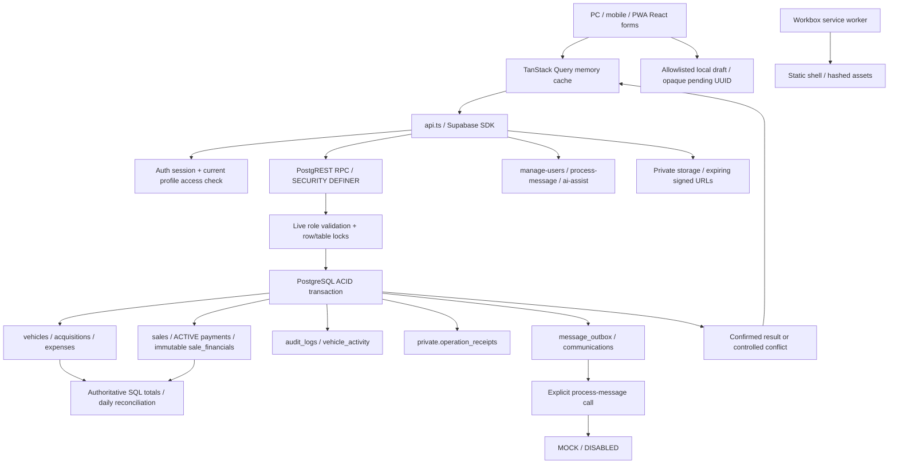

# CRM reliability master audit — 06/10/2026

> Báo cáo này giữ bằng chứng vòng audit gốc. Kết quả xử lý 5 FAIL và kiểm chứng bổ sung hiện tại nằm ở [CRM_RELIABILITY_REMEDIATION.md](CRM_RELIABILITY_REMEDIATION.md) và [RELEASE_ENVIRONMENT_VERIFICATION.md](RELEASE_ENVIRONMENT_VERIFICATION.md). Không dùng các FAIL/kết quả suite cũ ở đây làm trạng thái cuối của workspace đã sửa.

## 1. Kết luận và phạm vi

**NOT READY để phát hành toàn bộ workspace theo quality gate đã yêu cầu.** Các bản sửa local đã có kiểm chứng; những đường gọi tương thích cũ và một số rủi ro recovery vẫn chưa đạt. Không suy an toàn toàn diện từ regression xanh.

Đây là vòng tiếp theo sau audit trước. Báo cáo chính này cùng hai phụ lục bao phủ kiến trúc, 25 tình huống concurrency, đủ B1–B16, security, fixes, tests, Git và rollout:

- [Kiến trúc, 25 tình huống và PostgreSQL fault injection](ARCHITECTURE_CONCURRENCY_AUDIT.md).
- [Security/session/storage và B1–B16 theo phạm vi](SECURITY_RECOVERY_AUDIT.md).
- [Phân loại baseline 40 file từ các yêu cầu trước](WORKSPACE_CONCURRENCY_REVIEW.md); đây là lịch sử trước vòng master, không dùng kết quả cũ làm kết quả cuối.

Môi trường kiểm tra là workspace local, PostgreSQL disposable và Chromium với dữ liệu giả. E2E Auth/API dùng transport test; không kiểm tra production JWT/gateway/GoTrue bằng mock. Không dùng khách hàng thật, không gửi tin nhắn, không stage/commit/push/deploy, không sửa production. Không thêm dependency; các migration cũ và verified snapshots giữ nguyên.

**Stack thực tế:** React 19, TypeScript, Vite 7, React Router, TanStack Query, React Hook Form/Zod; Supabase Auth/PostgREST/RPC/Storage/Edge; Vercel static SPA; Workbox PWA. Repository không có Next.js API routes/server actions.

## 2. Architecture map và nguồn sự thật

- Thu xe: vehicle + financials + acquisition + audits nằm trong cùng RPC transaction. Batch import khóa bảng, validate và ghi toàn batch; lỗi dòng sau rollback toàn bộ.
- Bán: khóa vehicle; kiểm tra state/cost/date trong server; sale + snapshot + initial payment + SOLD + audit cùng transaction. Partial unique index giữ tối đa một sale COMPLETED/vehicle.
- Thu nợ: khóa vehicle→sale; tổng ACTIVE payments được tính dưới khóa, không tin số dư frontend. request_id là payment PK và server kiểm tra actor/payload trước replay.
- Hủy bán: void các khoản thu, giữ snapshot và lịch sử; không phải refund ledger xác nhận đã trả tiền thực tế.
- Chi phí: nguồn cost là purchase_price và ACTIVE vehicle expenses. Business expenses tách riêng. Guard mới phát hiện form cũ, không đổi công thức tiền.
- Reports/debt/daily reconciliation đọc transactions authoritative. Không có mutable debt master, customer master edit hoặc signed daily close trong repo.
- Audit và nguồn tài chính trong PostgreSQL là nguồn sự thật. Query cache/local draft/SW không phải sổ giao dịch.
- Auth Admin + profile trong Edge không cùng một transaction; hosted compensation/race chưa được chứng minh.

## 3. Concurrency risk matrix — trạng thái hiện tại

Bằng chứng chi tiết theo function/migration/query và baseline reproduction ở phụ lục kiến trúc. CORE = tests/db/concurrency-audit.mjs; EXT = tests/db/extended-concurrency-audit.mjs. Các test concurrency mở session độc lập, dùng barriers và xác minh lock wait thật qua pg_stat_activity. Retry sau commit tuần tự được ghi rõ là replay, không giả là concurrency.

| # | Operation / scenario | Bảo vệ, failure mode và hướng xử lý | Evidence / status hiện tại |
|---|---|---|---|
| A1 | Hai người bán cùng xe | Vehicle FOR UPDATE + state check + completed-sale unique + ACID. Người thua nhận conflict, không tạo payment/snapshot rời | CORE/DB/E2E lifecycle: **PASS** cho một completed sale |
| 1 | Hai người thu cùng chassis | Migration 060004 canonical unique upper(trim); wrapper normalize. Existing canonical duplicates làm migration dừng, không tự merge | CORE + EXT: **PASS** |
| 2 | Bán vs Đang cọc | Cùng vehicle lock; RESERVED bán được theo nghiệp vụ hiện tại; SOLD không bị revert | CORE/EXT **PARTIAL**: status đúng, chưa có deposit ownership/amount |
| 3 | Hai người Đang cọc | Current form dùng expected_updated_at; stale version reject | EXT **PARTIAL**; legacy no-token và tiền cọc thật chưa bảo vệ đầy đủ |
| 4 | Hủy cọc vs bán | Không có cancel-deposit/refund-deposit entity/RPC | **NOT VERIFIED**, tính năng không hiện diện; không invent trạng thái |
| 5 | Sửa xe vs bán | Vehicle lock, cost snapshot bất biến, stale current form guard | CORE/EXT **PARTIAL**; legacy metadata edits có thể last writer |
| 6 | Đổi status vs giao dịch | Backend cấm trực tiếp SOLD, sale validate state dưới khóa | CORE/EXT **PASS** cho invariant SOLD/inventory |
| 7 | Hai người sửa customer | Customers là aggregate sales/phone; không có customer master edit | **NOT VERIFIED**; showroom lead status revision chưa có |
| 8 | Sửa cùng debt | Balance derived. New due-date overload + snapshot token chặn lost update | Due-date DB8/E2E **PARTIAL**; legacy2args diagnostic **FAIL** |
| 9 | Hai khoản thanh toán riêng | Vehicle→sale lock và exact balance; tổng không vượt debt | CORE/DB **PASS** cho bảo toàn số dư |
| 10 | Cùng khoản tiền thực tế | Same UUID replay đúng; different UUID không thể nhận ra cùng chứng từ nếu không có receipt identity | CORE **FAIL**, P0 sai sổ có thể xảy ra. Cần định danh chứng từ dùng chung; không dedup theo amount/date |
| 11 | Refund vs sửa/reconcile payment | Sale cancellation void history; không refund ledger hoặc payment edit RPC | **NOT VERIFIED** cho tiền hoàn thực tế |
| 12 | Hai người hủy giao dịch | Locks/state guards; immutable history | EXT **PASS** các cancellation đã test; không suy mọi entity đều pass |
| 13 | Delete/disable vs sử dụng | Core state locks và referential history guards; role recheck trên các paths đã sửa | EXT **PARTIAL**, các mutators/hosted admin còn chưa test |
| 14 | OWNER disable STAFF lúc gửi | Post-lock role validation trong sale/payment/vehicle/expense/due/delete-acquisition/delete-vehicle paths đã kiểm chứng | CORE/EXT/focused DB **PARTIAL**; tất cả RPC và mọi timing chưa được chứng minh |
| 15 | Finance thay đổi lúc đối soát ngày | Query totals authoritative snapshot; không có chốt quỹ thật/close-day mutation | DB report regression **PARTIAL**; reconciliation full workflow không có |
| 16 | CSV import vs manual intake | Table lock, validation, canonical unique; row conflict rollback whole batch | EXT **PASS** cho tested chassis overlap |
| 17 | Background vs staff | Atomic claim; canceled-before-claim blocked; outbox failure trace | EXT **PARTIAL**; PROCESSING crash recovery **FAIL**; in-flight provider cancellation chưa verified |
| 18 | Nhiều thiết bị một account | Server invariants; request receipts actor/op scoped | **PARTIAL**; independent keys/storage deletion không nhận diện cùng real receipt |
| 19 | Nhiều tab gửi chồng | Same-key payment/operation returns same result; logout propagation tested | **PARTIAL**; local UUID creation giữa tab không phải atomic shared-intent protocol |
| 20 | Stale tab | Vehicle/expense/due current forms giữ revision lúc mở, fail closed thiếu token ở expense/due | **PARTIAL**; old caller không token vẫn có FAIL |
| 21 | Hủy sale vs resale | Consistent vehicle→sale order; one completed sale, snapshots retained | EXT **PASS** |
| 22 | Records chồng một phần | Migration060006 thống nhất vehicle→acquisition; không lock acquisition trước vehicle | EXT **PASS** cặp đã tái hiện; exhaustive lock graph chưa verified |
| 23 | Deadlock/write skew | Real40P01 baseline đã sửa ở acquisition/delete; constraints/payments/owner locks bảo vệ các invariant scoped | **PARTIAL**; chưa có exhaustive stress/fuzz |
| 24 | Cash thông tin thay đổi đồng thời | Payments phương thức immutable tại create; không cash reconciliation editor riêng | **PARTIAL** số dư; same real cash receipt khác key vẫn FAIL |
| 25 | Bulk overlap | Import max500, atomic table lock; trigger fault ở dòng sau rollback cả batch | EXT **PASS** tested import; không có bulk sale/delete workflow |

## 4. B1–B16 failure recovery matrix

Mỗi status giới hạn theo evidence; hardware/hosted claims giữ NOT VERIFIED. Draft là input local chưa xác nhận; Saving là mutation pending; Checking là lookup; Confirmed chỉ có server result/committed receipt; Conflict có error cụ thể. Pending UUID chỉ biểu thị cần đối soát, không chứng minh chưa commit. Chưa có một state machine chung hoàn chỉnh cho mọi action.

| Case | Path / hiện trạng và tác động | Recovery nhỏ nhất và evidence / acceptance còn thiếu | Severity / status |
|---|---|---|---|
| B1 Mất internet | API ensureOnline, offline banner, draft allowlist; không ghi nghiệp vụ offline | E2E offline sale không RPC; static shell offline PASS. Nhập lại money/PII/notes; reconnect, revalidate | P1 / **PARTIAL** toàn hệ thống |
| B2 Chập chờn | Query retry1, mutation retryfalse; network error là unknown result | Stable operation/payment ID + manual lookup; 503-before-commit và abort-after-commit E2E. Chưa chạy burst disconnect toàn app | P1 / **PARTIAL** |
| B3 Rất chậm | Saving button và input giữ state; không success trước server | E2E barrier giữ sale request, pending/one request/zero sale trước release, one sale sau. Logout delay privacy test | P1 / **PASS** các path tested; stress latency chưa verified |
| B4 Mất khi Save | Thu thường/thu batch/bán có durable UUID và receipt backend, payment có UUID lookup | E2E real RPC commit→abort→reload→check; đúng một acquisition/import/sale/payment. Storage mất hoặc legacy keyless vẫn rủi ro | P0 baseline / **PARTIAL** sau sửa |
| B5 F5/đóng tab | Draft debounce350ms; guard beforeunload/navigation; excludes money/names/phone/notes | Unit/draft regressions; replay reload E2E. Fields ngoài allowlist phải nhập lại; tab close physical không fully verified | P2 / **PARTIAL** |
| B6 Hết pin | Browser storage opaque pending survives reload nếu đã flush | Reload acceptance PASS; physical phone power loss/iOS eviction chưa test. Không cam kết background sync khi app đóng | P1 / **NOT VERIFIED** hardware |
| B7 Hai người bán | Atomic state/unique/snapshots | PostgreSQL overlapping sessions + lifecycle assertions | P0 risk / **PASS** invariant tested |
| B8 Nhiều tab | Query cache không live coherent cho mọi entity; actor scoped recovery; cross-tab logout | Server guard + same-key races PASS; cross-tab logout Auth test PASS. Two devices independent keys/shared local intent chưa verified | P1 / **PARTIAL** |
| B9 Session hết hạn | SDK refresh, AuthProvider profile/access checks; rejected refresh no loading loop | Auth E2E401 giữ input/no false success, logout, refresh401→login PASS. Hosted rotation/signature NOT VERIFIED | P1 / **PARTIAL** |
| B10 Backend outage | API errors, no auto financial retry; auth access failures close gate | E2E503 business no commit, manual retry one sale; Auth503 recover; Edgepurge handler500 unit PASS. Hosted outages NOT VERIFIED | P1 / **PARTIAL** |
| B11 Stale modification | Expected revisions current vehicle/expense/due form; guarded RPC conflict | DB versioned overlap/E2E stale forms PASS; legacy diagnostics giữ FAIL | P0 money risk / **PARTIAL** |
| B12 Storage full/cleared/unavailable | Required UUID write fails before mutation; corrupted key fail closed; Auth/dictionary getters controlled | Unit quota/blocked/corrupt + browser storage tests PASS. Cleared pending key không thể reconstruct; phải manual history check. All stores/eviction NOT VERIFIED | P1 / **PARTIAL** |
| B13 Deployment mismatch | Workbox prompt, hashed static cache, no API runtime cache; server old signatures retained | Production worker byte-update lifecycle PASS: waiting preserves input, explicit activation/offline. Different frontend/assets/schema releases and Vercel rollback NOT VERIFIED | P1 / **PARTIAL** |
| B14 Background failure | Financial transaction separate from provider; queued outbox; bounded attempts; trace safe SQLSTATE on enqueue failure | EXT trigger failure keeps COMPLETED sale and audit PASS. Stuck PROCESSING **FAIL**; auto resend without provider outcome unsafe; PDF/provider crash unverified | P1 / **PARTIAL** |
| B15 Human error | Confirmations, reason, role, cancel/void history, immutable snapshots | DB/UI cancellation/delete/permission regressions PASS. Refund actually paid/restore Auth compensation NOT VERIFIED | P1 / **PARTIAL** |
| B16 Nhiều action đồng thời | Native PG multiple sessions/barriers, current revisions and lock ordering | CORE/EXT/focused suites quantify invariant/failures. Old client, all lock cycles, long load chưa closed | P0 potential / **PARTIAL** |

## 5. Findings theo mức độ, root cause và bản sửa

Severity ở vòng này dùng định nghĩa master: P0 gồm sai sổ/ghi đè tiền/bypass quyền có thể xảy ra; P1 recovery/vận hành; P2 UX/traceability; P3 cải tiến. Không tuyên bố đã gây thiệt hại tiền thật.

| Finding | Root cause chain / evidence | Bản sửa / phạm vi còn lại |
|---|---|---|
| P0 Intake retry không chassis | Missing response → old UI new request → acquire generates GEN frame mới → hai acquisition/vehicle. CORE baseline confirmed | Receipt table actor/op/request PK, SHA256 payload, same-tx result; durable UUID + checking UI cho intake/batch; native DB/E2E PASS. **Legacy keyless vẫn FAIL** |
| P0 Different keys cùng tiền | Hai form/device tạo UUID độc lập → add_payment coi là hai khoản hợp lệ → cả hai accepted nếu dư nợ đủ | **CÒN FAIL**. Chưa có receipt/master transaction reference chung; business identity cần chốt trước implementation. Không ép amount/time uniqueness |
| P0 Case variants chassis | Backend/raw unique case-sensitive → abc/ABC hai vehicles | Canonical unique index060004 + intake wrapper normalization. CORE/EXT PASS. Existing canonical duplicates phải review riêng trước migration; không tự sửa dữ liệu |
| P0 Stale expense financial overwrite | Expense form không version → row lock chỉ tuần tự hóa → cả hai cập nhật amount | Migration060005 + current editor baseline revision/controlled conflict. Focused DB11 và E2E PASS. **Legacy no-token vẫn FAIL** |
| P0 Disable trong lock wait | Role check trước wait → profile disabled commit → old check cho transaction tiếp tục | Rechecks sau locks ở scoped functions; actual revocation lock waits PASS. Không bảo đảm mọi mutator/timing/Edge admin; không claim global revocation safety |
| P1 Stale due-date | RPC2args không precondition → later date silently overwrites | New RPC3args + form revision; DB8/E2E PASS. **Legacy2args vẫn FAIL** |
| P1 Acquisition deadlock | Delete locks vehicle→acquisition; cancel/delete-acquisition locks acquisition→vehicle →40P01 | Migration060006 consistent order + re-read after locks + postwait role. Real ordered RPC races/revoked tests PASS; exhaustive graph NOT VERIFIED |
| P1 PROCESSING worker crash | Claim marks PROCESSING → process dies → claim only QUEUED, no lease/outcome reconciliation | **CÒN FAIL**. Không tự reclaim/resend vì provider có thể đã nhận; cần lease fencing + provider status/idempotency contract + manual recovery |
| P1 Logout pending privacy | UI waits Auth network → shared browser still shows business cache | Close access/cache immediately, generation guard, Vietnamese failure notice; delayed/cross-tab tests PASS. Local storage/devtools và other-issued tokens vẫn có giới hạn |
| P2 Auth/dictionary storage crash | Storage getter/setItem throws before helper catch; rejected refresh gate never ended | Auth adapter/login handling + deferred dictionary storage + loading SIGNED_OUT guard. Unit7/Auth E2E10 PASS |
| P2 Outbox missing trace/canceled job | Sale catches outbox exceptions silently; claim not gated on current sale | Migration060007 safe audit/log code+IDs, canceled-before-claim guard. EXT PASS. Already claimed/in-flight sending cancellation NOT VERIFIED |
| P2 Sensitive drafts/log exposure | Persisted names/phones/notes/dictionary; raw RPC errors | Prior local allowlists/scrub/DEV code-only log retained; opaque UUID only now. Convenience expense free-text/legacy keys, Error/Edge logs and DevTools remain PARTIAL |
| P2 Purge misreported failure | Response returned where outcome/error object expected | Prior handler fix/unit retained. Hosted Auth/profile atomicity, restore/purge race still NOT VERIFIED |
| P3 Harness listeners | Each pg pool checkout added listener to reused client | Reuse existing error listener; final native diagnostics no accumulated-warning storm. Test infrastructure change only |

## 6. Safe local implementation và remediation plan

### Đã triển khai trong vòng master

| Nhóm | Files / migration mới | Compatibility / performance / rollback |
|---|---|---|
| Stable operation recovery | src/lib/operationRecovery.ts; src/components/OperationRecoveryNotice.tsx; acquisition/intake/sell pages; migration060002_operation_receipts | UUID only client, result IDs/server hash only private table. New payload request_id; import accepts {rows,request_id}; old JSON arrays still callable. Receipt lock scoped actor/op/key, extra GET only pending recovery. Keep receipts on rollback; do not drop ambiguous outcome history |
| Payment corrupt identity | src/lib/paymentRecovery.ts + unit | Corrupt UUID stops new submission, no silent replacement. Deleted storage still cannot recover identity |
| Due/expense optimistic concurrency | ReceivablesPage, ExpensePages, errors/types; migrations060001/060005 | New caller snapshot token, monotonic revision. Due2args and no-token expenses remain compatible/unsafe; must retire/gate old clients before release claim. Never blindly auto retry40001 |
| Canonical frame uniqueness | migration060004 | Non-destructive index; preflight duplicates; normal CREATE INDEX can block writes during rollout. Use maintenance/staging rehearsal, no auto merge. Removing index weakens protection; rollback should fix forward |
| Acquisition lock order | migration060006 | Same reason/permission/audit/accounting semantics; vehicle first. New order must remain in all future related RPCs |
| Secondary-task safety | migration060007 | Keep sale independent from messaging; safe code-only incident. No claim for already canceled sale. No automatic PROCESSING retry, no provider added |
| Auth/storage | supabase.ts, AuthProvider, LoginPage, dictionary callsites | Current tokens/key compatible; UI closes before network. Pending IDs retained scoped by user. Rollback frontend alone preserves server receipts |
| Tests/docs | native DB receipts/due/expense suites added to test-db runner; CORE/EXT diagnostics; Auth/conflict/recovery/503/slow E2E; unit; check-pwa-upgrade | Diagnostics remain FAIL for unprotected paths. Fixtures updated for actual new request envelope; same money/count assertions retained |
| Knowledge contract | docs/SYSTEM_REFERENCE.md, build-knowledge-seed.mjs; forward060008_knowledge_reseed | Historical038 seed now protected, not rewritten. 184 sections generated/check verified; frontend/schema contract docs aligned |

### Còn phải làm trước release

1. **P0:** chốt receipt identity chung giữa nhân viên/thiết bị, rồi enforce unique/reference backend; test real duplicate vs two legitimate same-amount payments. Đây là thay đổi nghiệp vụ không được đoán bằng amount/date.
2. **P0/P1:** chặn hoặc nâng cấp legacy clients không có UUID/revision; test old/new tabs rollout. Optional guards là bước tương thích, chưa là gate toàn hệ thống. Có thể dùng staged minimum-client protocol, nhưng phải thiết kế và kiểm chứng migration/UI rollout trước.
3. **P1:** PROCESSING recovery cần lease/attempt fencing và contract provider status/idempotency. Manual recovery phải kiểm tra delivery trước retry; không bật resend tự động với unknown outcome.
4. **P1:** mở rộng proven post-lock permission rechecks cho cancel_sale/cancel_expense và các mutators khác sau repro; hosted manage-users ownership/revoke/compensation riêng.
5. **P2:** audit local convenience descriptions/dormant legacy keys, sanitize error logs end-to-end, signed-URL TTL/shared-device policy. Không xóa pending identity khi logout chỉ để làm sạch browser.
6. Chạy real hosted test environment cho PostgREST overload/grants, Deno handlers, GoTrue rotation; physical mobile/process kill và full two-asset/schema-version PWA rollout.

Không thêm Redis/Kafka/Dexie/IndexedDB business queue. Local draft và opaque pending IDs đủ cho phần recovery đang được hỗ trợ. IndexedDB có thể hữu ích nếu volume/media drafts tăng; hiện chưa có yêu cầu chứng minh để thêm persistence layer mới. Không tự hoàn tất thu/bán/payment offline. Do not assume iOS background sync after close.

## 7. Test evidence — sau source freeze

Kết quả cuối được cập nhật sau các run hoàn tất; các focused failures do selector sai/mất shared test server đã sửa ở harness/locator phù hợp actual UI, không được tính là business proof.

| Suite | Result thực tế |
|---|---|
| Whole lint | **PASS**, exit0 |
| Whole typecheck | **PASS**, exit0 |
| Production build | **PASS**, exit0,63 precache entries. Zod/Rollup annotation warnings remain non-fatal |
| Unit | **352 PASS / 33 files** |
| Database/RLS/integration | **PASS**, native PostgreSQL; migration replay + original suites + due8/receipts5/expense11 + integration30 |
| Knowledge | **PASS**, generated reference and forward seed,184 sections |
| Full E2E | **108/108 PASS**, exit0,4.5m; includes new recovery/503/slow/Auth/conflict cases |
| PWA4173 | **PASS** manifest/installability/controller/static-cache/no API cache/offline→online |
| PWA worker upgrade | **PASS scoped** real production Workbox worker byte change waiting→explicit update→activated→offline. Different asset/schema builds **NOT VERIFIED** |
| CORE diagnostic | **13 PASS / 3 FAIL**, exit1: legacy unkeyed intake retry, actual receipt different keys, legacy due-date2args |
| EXT diagnostic | **20 PASS / 2 FAIL**, exit1: legacy no-token expense overwrite, crashed PROCESSING recovery |
| Focused operation receipt DB | **5/5 PASS**, concurrent same-ID intake/sale/batch, payload conflict, actor isolation, rollback |
| Focused due/expense DB | **19/19 PASS**; included in full DB runner |
| Focused Auth E2E/unit | **10/10**, **7/7 PASS**; full E2E will include browser cases |
| Focused new recovery E2E | Intake after corrected label **1/1 PASS**; sale/batch **2/2 PASS**; full suite includes all3 |
| Hosted/Deno/real devices | **NOT VERIFIED** |

CORE baseline before master had11PASS/3FAIL. New keyed intake and versioned due guards are separately tested; new legacy diagnostics preserve the remaining failure rather than deleting the old weakness. EXT baseline observed17checks=10PASS/7FAIL; expanded final22checks=20PASS/2FAIL. Counts differ because coverage grew. Aggregate unique systems are not inferred by adding overlapping suites.

Log capture for diagnostics is under C:/Users/Admin/AppData/Local/Temp/carem-audit-01a10c9a-20261006. Full E2E/database log in ignored test-results; Playwright cleans that directory on startup, so it is not a durable archive. Reproduction commands and evidence are retained in this report/tests.

## 8. Git workspace và release readiness

Baseline trước master có30modified/10untracked, staged trống, không deleted; classification từng file ở báo cáo baseline. Các thay đổi cũ UI/accessibility/format/toast/purge vẫn được bảo toàn. Những file trộn phải review theo hunk; không git add . hoặc dựa tracked/untracked để suy coverage.

Trạng thái cuối: **39 modified /32 untracked /0 deleted /0 staged**. git diff --check PASS. Các log test/build nằm ngoài commit hoặc ignored; không thêm dependency/config deployment.

### File mới/thêm phạm vi ở master, ngoài danh sách baseline

| Files | Nguồn gốc / kiểm chứng |
|---|---|
| docs/ARCHITECTURE_CONCURRENCY_AUDIT.md; docs/SECURITY_RECOVERY_AUDIT.md; docs/CRM_RELIABILITY_MASTER_AUDIT.md | Vòng master, báo cáo evidence/current-vs-baseline |
| docs/SYSTEM_REFERENCE.md; scripts/build-knowledge-seed.mjs; migration060008 | Vòng master, forward knowledge update; historical seed không sửa |
| scripts/db-harness.mjs; scripts/test-db.mjs | Vòng master, listener fix/integrated new DB suites; full DB PASS |
| scripts/check-pwa-upgrade.mjs | Vòng master, scoped upgrade lifecycle PASS |
| src/components/OperationRecoveryNotice.tsx; src/lib/operationRecovery.ts | Vòng master, stable operation recovery; unit/nativeDB/E2E |
| src/features/auth/AuthProvider.tsx; src/features/auth/LoginPage.tsx; src/lib/supabase.ts | Vòng master, auth/storage/privacy fixes; unit/E2E |
| src/features/expenses/ExpensePages.tsx; src/features/sales/ReceivablesPage.tsx | Vòng master, guarded edit callers/accessibility; nativeDB/E2E |
| migrations060001,060002,060004,060005,060006,060007 | Vòng master local pending, non-destructive forward guards; native replay/tests |
| tests/db/operation-receipts.test.mjs; tests/db/sale-due-date-conflict.test.mjs; tests/db/expense-conflict.test.mjs; tests/db/extended-concurrency-audit.mjs | Vòng master, actual PostgreSQL tests/diagnostics |
| tests/e2e/auth-failure-recovery.spec.mjs; tests/e2e/sale-due-date-conflict.spec.mjs | Vòng master, scoped failure/conflict cases |
| tests/unit/auth-storage.test.ts; tests/unit/operationRecovery.test.ts; tests/unit/sale-due-date-conflict.test.ts | Vòng master, storage/recovery/conflict tests |

### Baseline files có thêm hunk ở vòng master

AcquisitionFormPage/ShorthandIntakePage/SellVehiclePage thêm stable recovery; ShorthandIntakePage thêm friendlyError và deferred storage; errors.ts/types thêm conflict/revision; paymentRecovery và payment tests thêm corrupt-key fail closed; business-flows E2E thêm intake/batch/sale/503/slow failure injection; shorthand E2E đổi actual request envelope và vẫn giữ row/count/money assertions; CORE diagnostics thêm new guard plus explicit legacy failure. Baseline formDrafts/privacy/UI/accessibility/purge hunks giữ nguyên.

Limited dirty/untracked text scan không có private-key PEM/sb_secret/live-token literal candidate; không in giá trị nhạy cảm. Không có full Git-history secret scan; không chứng nhận toàn repo/history không có secret. .env.local/dist/test-results ignored. Không package/dependency change. Không dùng snapshot rebuild để che UI khác biệt.

### Chia commit đề xuất, chưa thực hiện

Giữ các nhóm baseline UI/format/flexible-intake/purge riêng. Vòng master chia: (1) backend operation receipts + client recovery + tests, (2) due/expense version guards + callers/tests, (3) canonical identity + lock-order guards/tests, (4) communication trace/claim tests, (5) Auth/storage + tests, (6) integrated harness/PWA/knowledge/report. File trộn stage theo hunk và dependencies. Review từng tập commit; toàn workspace PASS regression không tự chứng minh mỗi tập commit con độc lập.

### Release checklist và rollout/rollback (chưa triển khai)

- [ ] Giải quyết/chấp nhận có chủ đích các FAIL bằng business contract và tests; chưa đủ cơ sở phát hành toàn workspace hiện tại.
- [ ] Review tất cả pending migrations từ baseline010/011/012 và master001/002/004/005/006/007/008; không áp dụng riêng frontend new contract trước backend.
- [ ] Read-only preflight canonical chassis collision: đếm nhóm upper(trim(frame_number)) having count>1; kiểm tra tất cả record references. Không auto merge/delete data.
- [ ] Xác minh backup gần nhất, restore trên database test và reconcile inventory/payment/snapshot/audit counts. Backup production/restore thật **NOT VERIFIED** trong phiên này; không chạy scripts prod.
- [ ] Rehearse migration transaction/locks trên staging snapshot đã ẩn danh, kiểm tra PostgREST schema cache/overloads/grants và Deno.
- [ ] Rollout backend guards trước current frontend; quản lý old tabs/PWA có guard bắt buộc hoặc clear retirement window trước tuyên bố no legacy loss.
- [ ] Canary test receipt replay/current stale edits/messaging trace/Auth logout; không production chaos/concurrency.
- [ ] Theo dõi conflict/receipt/outbox incidents bằng UUID/code, không PII. Không thêm monitoring service khi chưa có requirement cụ thể; Sentry chưa thấy integration trong repo.
- [ ] Rollback frontend không drop receipts/snapshots/history. Backend corrective migration fix forward; không sửa migrations đã apply. Giữ lookup/replay để đối soát giao dịch đang unknown.

**Final quality gate: PARTIAL / NOT READY.** Current guarded flows được kiểm chứng, nhưng five diagnostic failures và các mục NOT VERIFIED vẫn cần xử lý trước khi có thể cam kết toàn hệ thống đạt master prompt.
