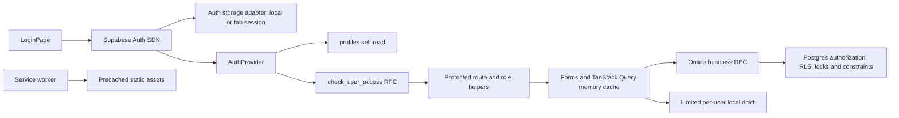

# Security, sessions, browser storage and failure recovery audit

Date: 2026-10-06. Scope: local repository and synthetic Chromium tests only. This is a scoped supplement to the complete concurrency/reliability report. No production database, hosted Auth, real user account, customer message, deployment, staging or commit was touched.

## Existing architecture and trust boundaries

- This repository uses Vite/React, not Next.js. `vercel.json` describes a static Vite build and SPA rewrite. There is no additional server/API layer in this checkout.
- `src/lib/supabase.ts` configures Auth persistence, automatic token refresh and PKCE. Auth tokens necessarily live in browser storage when persistence is selected; the password is passed to Auth and is not written by application storage helpers.
- `src/features/auth/AuthProvider.tsx` loads the current profile and `check_user_access` concurrently, rejects inactive/deleted/missing profiles and unavailable access evaluation, and clears the query cache when the verified identity/role changes. It checks again on window focus and every 60 seconds. The verified role is a UI gate, not a replacement for database authorization.
- `src/main.tsx`: read queries retry once; business mutations do not retry automatically and use network mode `always`. Supabase Auth has its own token refresh implementation, so this setting does not describe Auth refresh retries.
- `vite.config.ts`: service worker precaches static files, has no runtime API caching, prompts before update and cleans outdated caches. `src/components/PwaUpdate.tsx` warns the user to save before update. The repository contains no IndexedDB/Dexie business queue. The absence of an offline queue is appropriate for these financial operations; adding one would widen the recovery and security problem.
- Only notifications have a Realtime subscription (`src/lib/useNotifications.ts`). Vehicle/customer/debt forms are not synchronized live across all tabs. Logout propagation in two tabs was tested; this does not establish business cache coherence between tabs.

## Proven weaknesses and local fixes

| Finding | Severity and impact | Reproduction before change | Change and acceptance evidence |
|---|---|---|---|
| Auth storage failures were not controlled | P2: blocked getters/QuotaExceededError could break initialization or reject form submission without a useful error | Inject throwing Storage getters, or throwing `Storage.prototype.setItem`, then submit login. Before remediation, getters yielded a generic alert and SDK/page errors; quota produced no controlled form alert | `src/lib/supabase.ts:6` reads inaccessible storage as no accessible session; writes fail with an explicit Vietnamese error. `LoginPage.tsx:50` wraps preference and sign-in in a catch. Seven unit cases and browser getter/quota cases PASS |
| Logout kept private UI open until network completed | P1: a shared device still displayed authenticated content after clicking logout during a stalled request | Hold `/auth/v1/logout` with a Promise barrier. Before change, the app remained on the private dashboard after the two-second acceptance window | `AuthProvider.tsx:187` closes user/profile/cache immediately, invalidates pending refreshes, and prevents refresh from restoring the old identity. Sign-in is disabled while logout is pending. Browser delayed-response and two-tab logout cases PASS |
| Rejected refresh could leave a loading gate stuck after local logout guard | P2: the initial session refresh was invalidated by SIGNED_OUT while the replacement refresh was suppressed | Persist a synthetic session with expired `expires_at`; Auth refresh returns 401 `refresh_token_not_found`. The initial hardened build stayed on `Đang tải dữ liệu…` | `AuthProvider.tsx:157` finishes loading on SIGNED_OUT. The test now reaches login and contains no private profile UI. This fix was made during this audit, after its test failed |
| Shorthand intake read Storage before its helper guard | P2: changing browser storage permission while authenticated could crash the route | Authenticate, inject a throwing localStorage getter, then navigate to `/intake` within the SPA. The expected intake heading failed before the fix | `ShorthandIntakePage.tsx` defers its three dictionary storage accesses through a tiny lazy adapter, allowing the existing guarded dictionary read/write to catch the getter failure. The same browser acceptance case now PASS |

Auth writes remove the obsolete other-storage copy before writing the new copy. A quota failure therefore does not leave a newly written session in the store selected for that attempt. An unreadable remember preference fails closed rather than changing the user's privacy choice. Removal attempts both stores and reports incomplete cleanup instead of stopping at the first failed removal.

The UI gate remains closed if server logout fails; an explicit message distinguishes closing this screen from confirming logout with the server. A storage failure during removal tells the user to clear site data before handing the device to another person. Token removal and server revocation are distinct concerns: a JWT already issued to another device may remain usable until expiry, subject to the database's live profile authorization.

## Failure scenarios B1–B16

Statuses below describe the security/storage sub-audit. They do not supersede broader database and end-to-end results in the main report. PARTIAL means there is concrete protection or a scoped passing test, with remaining cases stated. NOT VERIFIED means no runtime test of that case was executed here.

| Case | Current path / evidence | Recovery and remaining limitation | Severity / result |
|---|---|---|---|
| B1 Complete disconnection | `AppLayout.tsx:371` offline alert; API preflight rejects offline business calls; `formDrafts.ts:43`, `useFormDraft.ts:34` save allowlisted vehicle/date fields | Continue entering supported fields; reconnect and revalidate server data before save. Personal names/phones, money and notes are excluded intentionally. Existing authenticated tab may still display memory-cached rows while offline; fresh offline cold start cannot verify access | P2 / PARTIAL |
| B2 Intermittent internet | Query retry once, mutation retry false (`main.tsx`); errors do not imply confirmation; Auth SDK refresh is separate | No blind business retry. Unknown transaction outcomes must use operation reconciliation from the main audit. Actual repeated disconnect/reconnect bursts were not injected by this subtask | P1 / PARTIAL |
| B3 Extremely slow connection | Pending form buttons, plus logout acceptance barrier in `auth-failure-recovery.spec.mjs` | Logout removes private content before server response. Delayed business transaction contention/repeated Save is covered by the broader audit, not this Auth fixture | P1 / PARTIAL |
| B4 Connection lost during Save | Stable pending-operation/payment identifiers and reconciliation are handled in separate main-audit files | Auth/cache changes never treat a local pending transaction as confirmed. This subtask did not execute lost-commit business RPCs and does not label them PASS from Auth mocks | P1 / NOT VERIFIED here |
| B5 Refresh/tab closure | `formDrafts.ts` stores limited per-user fields; unload attempts persistence; protected fields prompt before supported navigation | Supported vehicle/date fields can recover; unsaved prices, phone/name and notes cannot. A successful storage call is not server confirmation; manual re-entry is explicit | P2 / PARTIAL |
| B6 Battery loss/shutdown | Draft debounce is 350 ms; storage is localStorage rather than a guaranteed durable transaction log | Input since last storage write can be lost; browser eviction and physical storage flush are outside these tests. There is no reliable background execution promise after the PWA closes | P1 / NOT VERIFIED |
| B7 Simultaneous sale | PostgreSQL row locks/availability check and unique completed-sale index exist; separate database concurrency audit | Auth UI behavior alone cannot prove one-sale invariant. Use actual concurrent DB evidence from the main report | P0 impact if broken / NOT VERIFIED here |
| B8 Multiple tabs/windows | Supabase Auth event propagation; identity/version gate and cache clearing; browser two-tab logout test PASS | Remembered-session logout removes private UI in the other tab. Opt-out session remains out of localStorage and a fresh tab starts unauthenticated. No application-wide live business cache synchronization | P1 / PARTIAL |
| B9 Expired session | Browser expired stored session + rejected refresh 401 test; business save 401/PGRST301 test | Expired refresh returns to login. A rejected mutation sends one request, retains model input and shows `Phiên làm việc đã hết hạn. Vui lòng đăng nhập lại.` without navigation/success. Hosted JWT signature verification and every mutation's expired-session path not simulated here | P1 / PARTIAL; scoped tests PASS |
| B10 Backend outage | Browser `/check_user_access` returns 503 while a verified screen is open | Private content closes; a subsequent successful verified focus refresh reopens it. This does not verify a real Supabase regional outage, Auth retry storm or Edge outage | P1 / PARTIAL; scoped test PASS |
| B11 Stale record/permission data | `AuthProvider.tsx` refresh generation, identity comparison and cache clear; immutable vehicle-edit revision in `VehicleFormPage.tsx` | Role/access data is checked on focus/60-second interval. Synthetic active-to-inactive profile change removes private UI. Financial lost-update guarantees remain database responsibilities | P1 / PARTIAL |
| B12 Storage full/cleared/unavailable | Seven adapter unit tests: blocked getters, read fallback, remembered/tab-only modes, quota, unreadable preference, both-store removal; browser blocked/quota and authenticated shorthand permission-change tests | Login fails clearly before Auth mutation if preference cannot be stored. Shorthand no longer reads the Storage getter outside dictionary guards. Existing draft persistence returns false on failure. Other browser eviction/OS flush cases are not guaranteed. Clearing pending IDs can remove retry identity, so it is not equivalent to a successful reconciliation | P1/P2 / PARTIAL; scoped tests PASS |
| B13 Deployment mismatch | `vite.config.ts`, `PwaUpdate.tsx`, `vercel.json` cache headers | Prompted update and versioned static assets are present. No real two-version upgrade, active dirty-form update, stale Edge/frontend compatibility test or deployment was executed by this subtask | P1 / NOT VERIFIED |
| B14 Background failure | `process-message/index.ts` claim/send/finish/fail flow uses a transactional outbox identity, provider mode MOCK; real providers are absent | Primary sale should be independent of secondary delivery. Worker crash after claim, lost finish and stalled PROCESSING recovery require actual DB/worker evidence; not proved by Auth tests | P1 / PARTIAL |
| B15 Human error | Role helpers and Protected pages; server-authorized operation confirmation/cancellation flows; audit history retained | Logout has immediate privacy protection. Cancellation/refund restore semantics and administrator compensation are covered in the main audit. No new permissions or destructive buttons were introduced here | P1 / PARTIAL |
| B16 Concurrent employees/actions | Server RPC authorization and row locks; live revocation tests delegated to database audit | Synthetic revocation on an open page passes. No frontend lock/loading state is accepted as proof of backend concurrency safety | P0/P1 impact if broken / NOT VERIFIED here |

## Security and shared-device residual risks

1. **P2 — Local account-scoped storage is not encryption.** `recentVehicles.ts:22` keys utility data by user ID; drafts and abbreviation rules do the same. This prevents the app from loading user A's data for user B, but another person with browser/DevTools access can read retained local records. `saveLastExpense` stores free-text expense descriptions; legacy drafts/dictionary data can remain dormant until accessed. The new fixes do not add more personal fields. Pending financial operation IDs are intentionally retained for recovery and must not be deleted automatically on logout. A shared-device policy or deliberate cleanup design is still needed; account key prefixes are not a confidentiality guarantee.
2. **P2 — Storage eviction destroys supported local recovery.** Browser-cleared pending IDs cannot identify a previous server effect. Do not infer that a missing key proves the operation never happened. Storage writes are fail-closed where operation identity is required by the main audit.
3. **P1 — Revocation while a mutation is already in progress requires database protection.** The profile shown in the browser is at most the last check. Cached role/JWT metadata cannot authorize writes. Rechecks after business-row locks exist for some RPCs; the main database audit must classify every remaining operation. This subtask makes no all-RPC safety claim.
4. **P1 — Hosted administrative workflow is not one ACID transaction.** `manage-users/index.ts` checks Auth/profile/access before Auth Admin actions; database RPCs and Auth Admin calls use separate boundaries. Ownership transfer during a slow administrative action and compensation failure remain hosted/Deno cases requiring review. No risky architectural rewrite was attempted here.
5. **P2 — Logs are not proven free of personal data end-to-end.** `App.tsx:135` logs an Error object; Edge error paths log backend errors; `api.ts` Edge diagnostic branches log error contexts. These are concrete logging paths, not proof that real personal data leaked. No real logs were accessed. There is no application Sentry integration in the inspected source. Operation/audit IDs support database traceability, but global sanitized correlation logging is incomplete.
6. **P2 — Already issued signed URLs survive local logout until TTL.** `storageGateway.ts:22` vehicle URLs are 300 seconds and identity-document URLs 120 seconds. Private buckets and new-read RLS do not revoke an already signed URL immediately. Tests of hosted signed URL reuse after logout were not run. No public storage policy was added.
7. **P1 — Browser tests mock Auth transport.** The new cases exercise the real app and actual Supabase browser SDK, but HTTP identity/profile/access responses are synthetic. They establish UI/storage/session lifecycle behavior, not GoTrue signature verification, real refresh-token rotation or Postgres RLS. Keep hosted settings and actual account-control tests separate.

## Exact changed files and safe rollout

| File | Reason |
|---|---|
| `src/lib/supabase.ts` | Guard inaccessible Storage getters, clear error on failed writes/removal, preserve remember-vs-tab privacy setting, export existing adapter for tests |
| `src/features/auth/LoginPage.tsx` | Catch preference/Auth failures; disable a new sign-in while logout is pending; show the existing form alert |
| `src/features/auth/AuthProvider.tsx` | Immediate logout cache/access gate, refresh generation guard, failed logout notice, finish loading on SIGNED_OUT |
| `src/features/intake/ShorthandIntakePage.tsx` | Exactly three dictionary callsites use deferred Storage access so the existing helper guards also cover throwing getters; main-audit operation changes were preserved |
| `tests/unit/auth-storage.test.ts` | Seven focused storage lifecycle/error acceptance cases |
| `tests/e2e/auth-failure-recovery.spec.mjs` | Browser failure injection, expired session/mutation, revoke/outage, delayed/cross-tab logout, remember opt-out; additional shorthand Storage getter diagnostic |
| `docs/SECURITY_RECOVERY_AUDIT.md` | Scoped evidence and remaining verification limits |

No database migration or dependency was introduced by this subtask. Existing role policies and business accounting were not edited. Rollout would require the normal frontend release procedure and the complete regression gate in the main report; this document does not authorize deployment. Rollback is a frontend code revert only and must preserve any pending-operation identifiers/data schemas created by the main audit. Token sessions remain compatible with the existing Supabase storage key.

## Executed focused evidence

- Baseline getter/quota tests failed before remediation. The logout barrier separately failed at the actual privacy acceptance assertion after fixing the test's profile selector. A preliminary selector failure was a fixture assertion issue and was not counted as proof of a product bug.
- `npx vitest run tests/unit/auth-storage.test.ts`: **7/7 PASS**, one file.
- `npx playwright test tests/e2e/auth-failure-recovery.spec.mjs --reporter=line`: **10/10 PASS**, 13.7 seconds, including the shorthand diagnostic after its proven fix.
- Focused ESLint across four edited source files and the two new test files: **PASS**, after all fixes.
- `npm run typecheck`: **PASS**, after all scoped code fixes.
- Whole-repository lint, typecheck, build, database, E2E, PWA and knowledge counts belong to the coordinating report; no duplicate or invented counts are given here.

**Release status for this scoped supplement: PARTIAL.** The verified session/storage fixes are reviewable local changes. They do not remove the remaining concurrency/reconciliation release blockers or turn physical-device/hosted verification into PASS.
